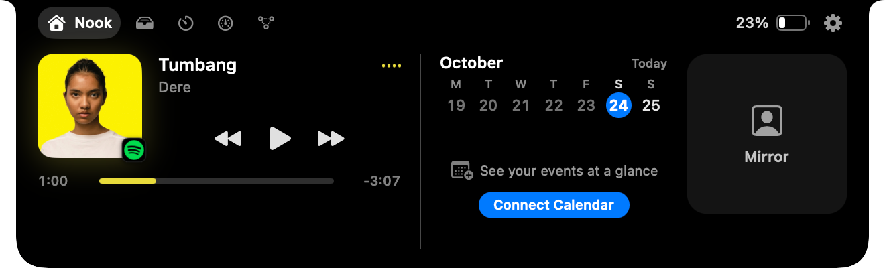
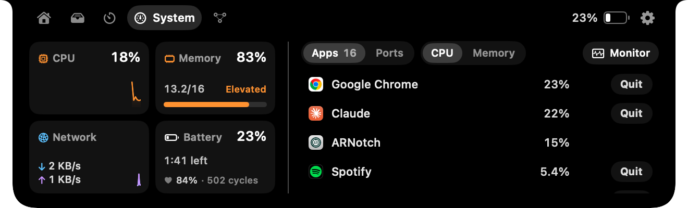
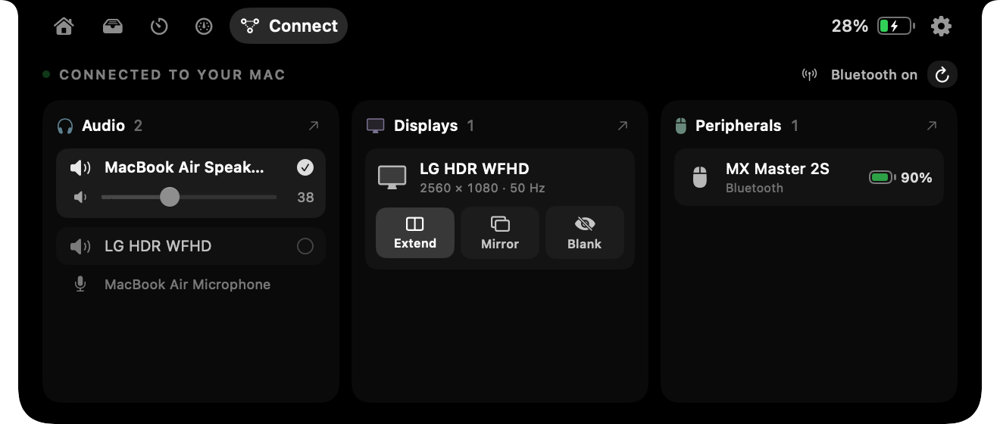
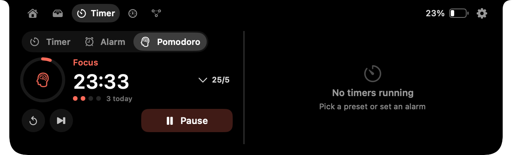
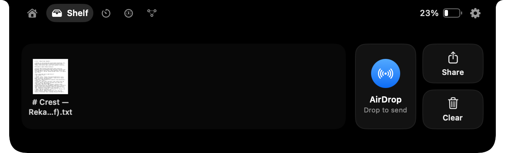

<p align="center">
  
</p>

<h1 align="center">ARNotch</h1>

<p align="center">
  Notch MacBook yang akhirnya berguna. Gratis, tanpa akun, tanpa license key.<br>
  <a href="https://www.adirp.id/2026/10/arnotch-elevate-your-mac.html">Baca ulasan & cerita pembuatannya di Blog</a> · <a href="https://www.adirp.id/">adirp.id</a>
</p>

<p align="center">
  
</p>

ARNotch adalah aplikasi macOS native (Swift + SwiftUI) yang mengubah notch MacBook menjadi panel interaktif. Arahkan kursor ke notch, dan panel terbuka berisi musik, file, timer, kondisi sistem, server localhost, serta perangkat yang tersambung. Saat tertutup, notch hanya melebar sedikit untuk menampilkan info penting, misalnya lagu yang diputar atau sisa waktu timer.

## Fitur

| Tab | Isi |
|---|---|
| **Nook** | Now Playing untuk apa pun yang diputar (Spotify, Apple Music, YouTube di browser, dan lainnya), kalender minggu ini (termasuk Google Calendar lewat akun macOS), cermin kamera dengan foto dan video |
| **Shelf** | Tempat file sementara: seret ke notch, seret keluar, AirDrop |
| **Timer** | Timer sekali klik, alarm jam tertentu, Pomodoro 25/5 |
| **System** | CPU, RAM, jaringan, kesehatan baterai (kapasitas dan siklus), aplikasi paling boros dengan Quit/Force Quit, deteksi aplikasi hang, daftar port localhost (Open/Copy/Stop) |
| **Connect** | Output suara, monitor eksternal (Extend/Mirror/Blank), baterai aksesori Bluetooth |

<p align="center">
  
  
</p>
<p align="center">
  
  
</p>

## Instalasi

1. Unduh **[ARNotch-1.0.0.dmg](https://github.com/jejakkamera/ARNotch/releases/download/v1.0.0/ARNotch-1.0.0.dmg)** (2,2 MB) via [GitHub Releases](https://github.com/jejakkamera/ARNotch/releases/latest), atau ambil dari folder [`release/`](release/).
2. Seret **ARNotch** ke folder **Applications**.
3. Buka ARNotch. Karena belum dinotarisasi Apple, macOS akan meminta konfirmasi: buka **System Settings → Privacy & Security**, lalu klik **Open Anyway**.
4. Aktifkan **Settings → Launch at login** agar ARNotch selalu berjalan.

Kebutuhan: macOS 14 Sonoma atau lebih baru, Apple Silicon. Di Mac tanpa notch, ARNotch membuat notch virtual.

## Build dari source

Hanya butuh **Command Line Tools** (Xcode tidak wajib).

```bash
./build.sh        # build release → dist/ARNotch.app
./make_dmg.sh     # build + dist/ARNotch-<versi>.dmg
```

- Selalu gunakan `/usr/bin/swift` bawaan Command Line Tools. Skrip di atas sudah melakukannya.
- `build.sh` menandatangani aplikasi dengan identitas **Apple Development** pertama di keychain (atau `CREST_SIGN_IDENTITY` jika di-set), lalu fallback ke ad-hoc. Dengan sertifikat tetap, izin macOS (kamera, kalender, dan lainnya) tidak hilang setiap kali build ulang.
- Untuk tes dengan flag debug, jalankan lewat LaunchServices, bukan langsung binary-nya:
  ```bash
  open -n dist/ARNotch.app --args --debug-open home   # home | shelf | timer | system | connectivity
  ```

Detail arsitektur dan catatan teknis ada di [docs/DEVELOPMENT.md](docs/DEVELOPMENT.md).

## Privasi

- Tidak ada akun, analytics, atau koneksi ke server mana pun.
- Kamera, mikrofon, kalender, Bluetooth, dan Accessibility hanya diminta saat fiturnya dipakai.
- Data metrik sistem hanya diukur saat notch terbuka.

## Dibuat oleh

**Adi Rizky Pratama** · [adirp.id](https://www.adirp.id/) · [Artikel Blog: ARNotch — Elevate Your Mac](https://www.adirp.id/2026/10/arnotch-elevate-your-mac.html)


## Lisensi

[MIT License](LICENSE) © 2026 Adi Rizky Pratama

